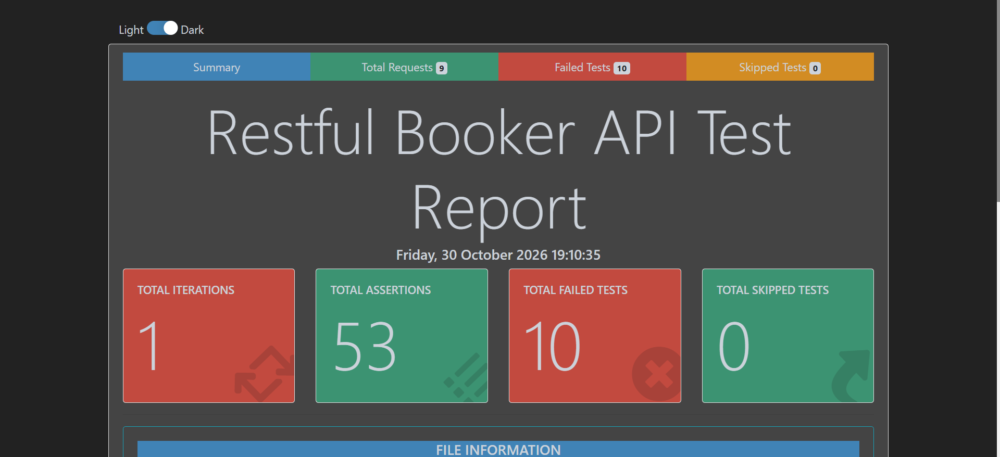

# 🏨 Restful Booker REST API Automation Testing

[](https://github.com/TanzimSQA/restful-booker-postman-api-testing/actions)
[](./Restful%20Booker%20API.postman_collection.json)
[](https://www.npmjs.com/package/newman)
[](https://www.npmjs.com/package/newman-reporter-htmlextra)
[](https://nodejs.org/)
[](./LICENSE)

A production-grade REST API test automation suite engineered for **[Restful Booker](https://restful-booker.herokuapp.com/apidoc/index.html)**. Built using **Postman Collection (v2.1.0)**, **Newman CLI**, dynamic token/ID chaining, automated faker data generation, robust defensive base URL handling, and rich HTML reporting with **GitHub Actions CI/CD** integration.

---

## 📑 Table of Contents
- [📌 Project Overview](#-project-overview)
- [🏗️ Repository Architecture](#️-repository-architecture)
- [🎯 API Endpoints Covered](#-api-endpoints-covered)
- [⚡ Key Testing Capabilities](#-key-testing-capabilities)
- [🛡️ Base URL Self-Healing Handler](#️-base-url-self-healing-handler)
- [🚀 Quick Start & Local Execution](#-quick-start--local-execution)
- [📊 HTML Extra Test Report](#-html-extra-test-report)
- [🔄 CI/CD Pipeline (GitHub Actions)](#-cicd-pipeline-github-actions)
- [👨‍💻 Author](#-author)

---

## 📌 Project Overview
**Restful Booker** is a mock hotel booking service created for software quality assurance and API test automation practice. This repository provides an end-to-end automated testing lifecycle verifying the full CRUD booking flow, authentication token generation, schema validation, response SLA limits, and health checks.

### Highlights
- **Full CRUD Workflow**: Token Creation ➔ Get Bookings ➔ Create Booking ➔ Fetch Booking Details ➔ Full Update (PUT) ➔ Partial Update (PATCH) ➔ Delete Booking ➔ Ping HealthCheck.
- **Dynamic Variable Chaining**: Token dynamically saved to environment upon authentication and automatically injected into subsequent headers (`Cookie: token={{token}}`).
- **Dynamic Booking ID Chaining**: Newly created `bookingid` is dynamically extracted from response and chained into GET, PUT, PATCH, and DELETE requests.
- **Realistic Data Generation**: Pre-request scripts leverage Postman dynamic faker variables (`{{$randomFirstName}}`, `{{$randomLastName}}`, `{{$randomInt}}`) and `moment.js` for dynamic check-in and check-out dates.
- **Automated Quality Gate**: Runs seamlessly in headless CI/CD environments with artifact report uploads.

---

## 🏗️ Repository Architecture

```text
├── .github/
│   └── workflows/
│       └── newman.yml          # GitHub Actions CI workflow
├── reports/
│   └── Restful_Booker_Newman_Report.html  # Newman HTML Extra report
├── Restful Booker API.postman_collection.json  # Postman Collection v2.1.0
├── RestfulBooker_Env.postman_environment.json   # Postman Environment Variables
├── package.json               # NPM scripts and runner dependencies
├── .gitignore                 # Version control exclusions
└── README.md                  # Comprehensive documentation
```

---

## 🎯 API Endpoints Covered

| # | Request Name | HTTP Method | Endpoint Path | Description | Status Code |
|---|--------------|-------------|---------------|-------------|:-----------:|
| 1 | **CreateToken** | `POST` | `/auth` | Generates authentication token for secure operations | `200 OK` |
| 2 | **GetBookingIds** | `GET` | `/booking/` | Retrieves available booking IDs | `200 OK` |
| 3 | **CreateBooking** | `POST` | `/booking` | Creates a new booking with dynamic payloads | `200 OK` |
| 4 | **GetBooking** | `GET` | `/booking/{id}` | Fetches detailed booking record by ID | `200 OK` |
| 5 | **UpdateBooking** | `PUT` | `/booking/{id}` | Complete update of booking data (Requires Auth) | `200 OK` |
| 6 | **PartialUpdateBooking** | `PATCH` | `/booking/{id}` | Partial update of booking fields (Requires Auth) | `200 OK` |
| 7 | **DeleteBooking** | `DELETE` | `/booking/{id}` | Deletes booking record by ID (Requires Auth) | `201 Created` |
| 8 | **GetBooking Copy** | `GET` | `/booking` | Verifies booking list consistency and response size | `200 OK` |
| 9 | **HealthCheck** | `GET` | `/ping` | Server health check endpoint | `201 Created` |

---

## ⚡ Key Testing Capabilities

### 1. Multi-Tier Assertion Strategy
Each request validates:
- **HTTP Status Code**: Strict expectation verification (`200 OK`, `201 Created`).
- **SLA Response Latency**: Performance checks ensuring response times remain below threshold (< 1000ms).
- **Payload Size Limits**: Verifying payload boundaries (< 1000 bytes for discrete endpoints, < 80 KB for list operations).
- **Data Integrity & Schema**: Verifying types (`string`, `number`, `boolean`, `object`) and non-empty values.

### 2. Pre-Request Dynamic Data Generation
```javascript
// Dynamic date handling with Moment.js
const moment = require('moment');
const checkin = moment().format('YYYY-MM-DD');
const checkout = moment().add(2, 'days').format('YYYY-MM-DD');

pm.environment.set("checkin", checkin);
pm.environment.set("checkout", checkout);
```

---

## 🛡️ Base URL Self-Healing Handler
To eliminate environment mismatch errors and missing variable issues (`Invalid URI "http:///..."` or trailing slash double-slashes), a collection-level pre-request script executes before every request:

```javascript
// Automatically resolve, sanitize, and fallback baseUrl
const defaultBaseUrl = 'https://restful-booker.herokuapp.com';
let currentBaseUrl = pm.environment.get('baseUrl') || pm.collectionVariables.get('baseUrl') || defaultBaseUrl;

if (!currentBaseUrl || typeof currentBaseUrl !== 'string' || currentBaseUrl.trim() === '') {
    currentBaseUrl = defaultBaseUrl;
}

currentBaseUrl = currentBaseUrl.trim().replace(/\/+$/, '');

if (!/^https?:\/\//i.test(currentBaseUrl)) {
    currentBaseUrl = 'https://' + currentBaseUrl;
}

pm.environment.set('baseUrl', currentBaseUrl);
pm.collectionVariables.set('baseUrl', currentBaseUrl);
```

---

## 🚀 Quick Start & Local Execution

### Prerequisites
- [Node.js](https://nodejs.org/) (v18.x or higher)
- [Postman App](https://www.postman.com/downloads/) (Optional, for GUI exploration)

### 1. Clone the Repository
```bash
git clone https://github.com/TanzimSQA/restful-booker-postman-api-testing.git
cd restful-booker-postman-api-testing
```

### 2. Install Dependencies
```bash
npm install
```

### 3. Run Tests via Newman CLI

**Console Summary Mode:**
```bash
npm test
```

**Generate Rich HTML Report:**
```bash
npm run test:report
```

Or run directly via Newman:
```bash
newman run "Restful Booker API.postman_collection.json" \
  -e "RestfulBooker_Env.postman_environment.json" \
  --delay-request 300 \
  -r cli,htmlextra \
  --reporter-htmlextra-export ./reports/Restful_Booker_Newman_Report.html \
  --reporter-htmlextra-title "Restful Booker API Test Report"
```

---

## 📊 HTML Extra Test Report
The test suite utilizes `newman-reporter-htmlextra` to generate an interactive, responsive dashboard featuring:
- **High-level KPI Summary**: Total requests, assertions executed/passed/failed, duration, and payload metrics.
- **Granular Request Breakdown**: Full request headers, request payloads, response bodies, and assertion details.
- **Interactive Filtering**: Filter by passed, failed, or skipped test cases.

### 📸 Execution Dashboard Preview
<p align="center">
  
</p>

The HTML report file is automatically generated and archived at:
```text
reports/Restful_Booker_Newman_Report.html
```

---

## 🔄 CI/CD Pipeline (GitHub Actions)
The included workflow `.github/workflows/newman.yml` executes on every push and pull request to `main`:
1. Checks out the code.
2. Installs Node.js, Newman, and `newman-reporter-htmlextra`.
3. Executes the complete test suite.
4. Generates and uploads the HTML Extra test report as a downloadable workflow artifact (`retention: 30 days`).

---

## 👨‍💻 Author
**Tanzim Rahman**  
*Software Quality Assurance Engineer*  
- **GitHub**: [@TanzimSQA](https://github.com/TanzimSQA)
- **LinkedIn**: [Tanzim Rahman](https://www.linkedin.com/in/tanzim-rahman-sqa)

---

## 📄 License
This project is licensed under the [MIT License](LICENSE).
